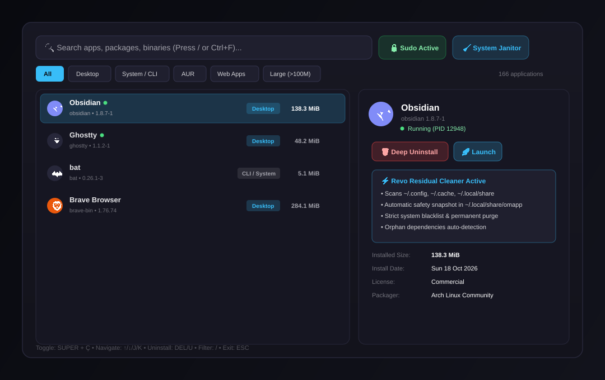

# OMAPP (Omarchy App Manager & Deep Uninstaller)

Native Quickshell overlay application manager, live process task manager, and deep uninstaller for Omarchy and Arch Linux. Track installed apps, package sizes, versions, update dates, running processes, and cleanly purge residual configurations and caches.



---

## Highlights

- **Complete Inventory**: Aggregates Desktop GUI applications, native Arch packages (`pacman`), AUR packages (`yay`), and Web Apps / PWAs into a single unified manager.
- **Fast Search & Sorting**: Instant search across names, packages, binaries, and descriptions. Sort by total disk footprint, install date, update date, or name.
- **Native Deep Cleaner**:
  - **Process Protection**: Automatically detects if an application is running and offers graceful termination before removal.
  - **Reverse Dependency Warning**: Alerts you if other installed packages depend on the application before you uninstall.
  - **Clean Package Removal**: Removes the system package non-interactively via pacman (`-Rns`).
  - **Residual File Hunter**: Deep scans `~/.config`, `~/.local/share`, `~/.cache`, `~/.local/state`, autostart entries, and dotdirs for leftover files.
  - **Interactive Checklist**: Review found leftovers with path and disk size before permanent deletion.
  - **Safety Net**: Automatically creates a timestamped config snapshot in `~/.local/share/omapp/backups/` before deleting.
  - **Orphan Janitor**: Detects and prunes unneeded orphan dependencies (`pacman -Qtdq`) created by the removal.
- **System Janitor Tab**: Dedicated 1-click cleaner for Orphan Dependencies, Pacman Package Cache (`paccache -r`), and AUR Yay Cache.
- **Session Sudo Caching**: Authenticates administrator credentials once via password prompt and keeps the session active with an automated keepalive loop.

---

## Installation

Install using the Omarchy plugin manager:

```bash
omarchy plugin add https://github.com/waldseelen/omarchy-omapp.git --enable
```

To remove:

```bash
omarchy plugin remove waldseelen.omapp
```

### Prerequisites

The following tools should be present on your Omarchy / Arch system:

- Quickshell with Wayland / LayerShell support (`omarchy-shell`)
- Standard Arch Linux package manager (`pacman`)
- Standard core utilities (`du`, `tar`, `ps`)

---

## Keybindings

| Keybinding | Action |
| :--- | :--- |
| `SUPER + Ç` | Toggle OMAPP overlay |
| `↓` / `J` | Select next application |
| `↑` / `K` | Select previous application |
| `/` or `Ctrl + F` | Focus search bar |
| `Tab` | Switch category tabs (All, Desktop, CLI/System, AUR, Web Apps, Large) |
| `Del` or `U` | Start Deep Uninstall workflow |
| `Enter` | Inspect application details |
| `Esc` | Close active dialog or exit OMAPP |

---

## Security & Safety Barriers

Permanent deletion of user files requires ironclad safety guarantees:

1. **System Path Blacklist**: Strictly refuses to target system roots (`/`, `/etc`, `/usr`, `/var`, `/home`, `/root`) or user home root (`~`).
2. **Protected Config Shield**: Never touches essential desktop configuration directories (`~/.config/hypr`, `~/.config/omarchy`, `~/.config/ghostty`, `~/.bashrc`, `~/.zshrc`, `~/.gitconfig`).
3. **Directory Depth Guard**: Only accepts paths with depth >= 2 relative to `$HOME` (e.g. `~/.config/appname`), preventing accidental parent directory deletion.
4. **Zero Argv Credential Leaks**: Administrator passwords and commands are streamed strictly through kernel standard input (`sudo -S -v`) and never exposed in `argv` or `/proc/<pid>/cmdline`.
5. **Pre-Purge Snapshots**: Saves a `.tar.gz` archive of residual files to `~/.local/share/omapp/backups/` prior to unlinking.

---

## License

MIT © 2026 waldseelen
